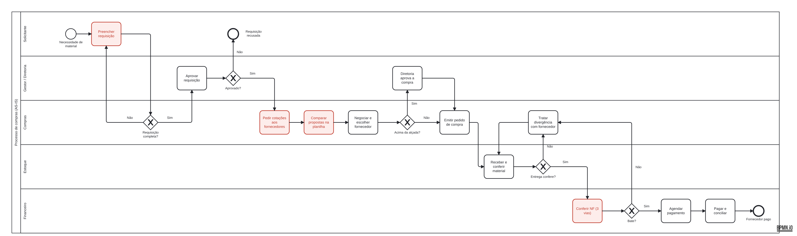
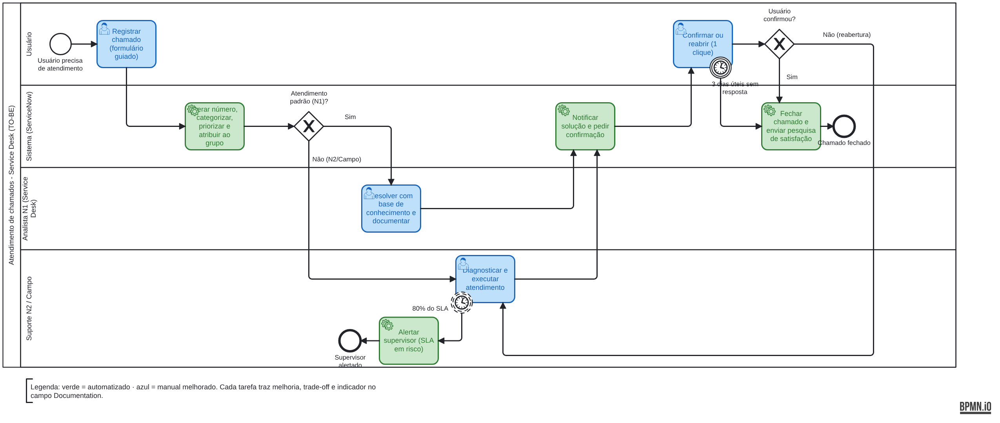

# Skills do Claude para processos e melhoria contínua

Duas skills para o [Claude](https://claude.ai) que ajudam a **mapear, analisar, automatizar e melhorar processos** com método: BPM, Lean e as ferramentas da qualidade. Escritas em português do Brasil, com foco em quem trabalha com processos no dia a dia: analistas, pontos focais de qualidade, supervisores e estudantes de Engenharia de Produção.

| Skill | Para que serve |
|---|---|
| [`mapeamento-automacao-processos`](skills/mapeamento-automacao-processos/SKILL.md) | Mapear um processo (escopo, SIPOC, BPMN), achar gargalos e desperdícios, desenhar o TO-BE e decidir o que automatizar. Gera o diagrama em arquivo `.bpmn`. |
| [`ferramentas-qualidade-melhoria-continua`](skills/ferramentas-qualidade-melhoria-continua/SKILL.md) | Investigar por que um indicador piorou e montar o plano de ação: PDCA, MASP, A3, DMAIC, Pareto, Ishikawa, 5 Porquês, carta de controle, FMEA, 5W2H e 5S. |

Juntas, elas cobrem o ciclo completo: **mapear → achar a causa → melhorar → padronizar → medir de novo**.



## O que muda na prática

Sem a skill, o Claude já sabe o que é um Pareto ou um BPMN. A skill acrescenta **método e disciplina**:

- **Indicador antes da solução.** Define a fórmula e a linha de base antes de propor qualquer melhoria.
- **Confirma que o problema é real.** Antes de buscar a causa de uma queda, checa se mudou a forma de medir, a amostra ou o volume.
- **Hipótese não é conclusão.** Sem dados, Ishikawa e 5 Porquês aparecem como hipóteses a testar, com o que coletar para confirmar.
- **Não inventa números.** Prazos, metas e custos ficam em aberto ou marcados como ilustrativos.
- **Redesenhar antes de automatizar.** Sobe a escada do mais simples (regras da ferramenta, planilha, Power Automate) até RPA só quando se justifica.
- **Explicita o trade-off.** Toda melhoria cobra algo, e a resposta diz o quê.
- **Diagrama conferido.** O `.bpmn` é validado e renderizado antes da entrega, e a resposta diz o que foi e o que não foi conferido.

## Como instalar

### No Claude (web, desktop ou celular)

1. Baixe os ZIPs da pasta [`dist/`](dist/):
   - [`mapeamento-automacao-processos.zip`](dist/mapeamento-automacao-processos.zip)
   - [`ferramentas-qualidade-melhoria-continua.zip`](dist/ferramentas-qualidade-melhoria-continua.zip)
2. No Claude, abra **Customize > Skills**, clique em **+** e escolha **Upload a skill**.
3. Envie um ZIP de cada vez e confira se as duas aparecem ligadas.

O uso de skills depende do plano e das configurações da sua conta. Se a opção não aparecer, veja a [central de ajuda do Claude](https://support.claude.com).

### No Claude Code

Copie as pastas de `skills/` para `~/.claude/skills/` (todas as suas sessões) ou para `.claude/skills/` dentro de um projeto:

```bash
git clone https://github.com/Oberon-23/claude-skills-processos-qualidade.git
cp -r claude-skills-processos-qualidade/skills/* ~/.claude/skills/
```

## Como usar

Não precisa chamar a skill pelo nome. Peça normalmente, e o Claude carrega a skill certa:

```text
Mapeia o processo de compras da minha empresa, da requisição até o pagamento.
Aponta os gargalos, onde dá para automatizar e gera o diagrama em .bpmn.
```

```text
O CSAT do nosso time caiu nos últimos dois meses.
Me ajuda a investigar a causa e montar um plano de ação.
```

```text
A taxa de reabertura de chamados está alta e gera retrabalho.
Mapeia como o processo funciona hoje, acha as causas e propõe a melhoria com um plano de controle.
```

```text
Monte um FMEA para o processo de expedição.
```

Quanto mais contexto e dados você der (exportação de sistema, planilha, números atuais e meta), mais concreta fica a resposta. Sem dados, a skill entrega o roteiro de investigação e diz exatamente o que coletar.

Para abrir os arquivos `.bpmn`, use o [demo.bpmn.io](https://demo.bpmn.io) (no navegador, sem instalar) ou o [Camunda Modeler](https://camunda.com/download/modeler/) (gratuito).

## Exemplos

Os diagramas abaixo foram gerados pelas skills em testes. Os cenários são **ilustrativos**, não representam nenhuma empresa real.

| Cenário | Arquivos |
|---|---|
| Atendimento de chamados (service desk), AS-IS e TO-BE | [`exemplos/service-desk/`](exemplos/service-desk/) |
| Compras de uma pequena indústria, AS-IS | [`exemplos/compras-industria/`](exemplos/compras-industria/) |

<details>
<summary>Ver o TO-BE do service desk</summary>



Cada tarefa do arquivo `.bpmn` traz, no campo *Documentation*, o que a mudança ataca, o trade-off e o indicador para acompanhar.

</details>

## Como foram testadas

Cada teste rodou num **chat novo, sem citar o nome da skill**, para checar se ela dispara sozinha e se a resposta segue o método.

| Teste | Skill | Resultado |
|---|---|---|
| Mapeamento do atendimento de chamados, com `.bpmn` | Processos | Disparou sozinha; SIPOC, VA/BVA/NVA, gargalos, TO-BE e arquivo renderizado |
| Mapeamento de compras industriais, com `.bpmn` | Processos | Funcionou fora do service desk; levou à regra contra números "típicos" sem fonte |
| Queda do CSAT | Ferramentas | Confirmou a queda antes de buscar causa; hipóteses, Pareto, Ishikawa e 5W2H |
| FMEA da abertura de chamados | Ferramentas | Escalas ajustáveis, convenção declarada, gravidade alta sobe a prioridade |
| Refugo numa fábrica de embalagens | Ferramentas | MASP, estratificação e hipóteses no chão de fábrica, sem números inventados |
| Reabertura de chamados | As duas juntas | Uma rodada só de perguntas; mapa → causas → PDCA → plano de controle |

O histórico de ajustes está no [CHANGELOG](CHANGELOG.md).

## Limites

- **Não substituem normas nem especialistas.** Em áreas reguladas (saúde, alimentos, segurança do trabalho, ISO específica), a skill dá o método, não o requisito.
- **Estatística avançada é rasa.** Cartas por atributo ou subgrupo, capacidade (Cpk), DOE e regressão aparecem em alto nível; a skill avisa quando chega nesse limite.
- **Resolvem um problema por vez.** Não acompanham uma carteira de projetos de melhoria ao longo do tempo.
- **A qualidade depende dos dados.** Sem números reais, o resultado é um roteiro de investigação, não um diagnóstico.

## Referências

As skills são um resumo próprio de práticas consolidadas de gestão de processos e da qualidade, escrito com palavras próprias. Não reproduzem trechos das obras abaixo, que são indicadas como leitura para aprofundar. Os autores e as instituições citados não têm relação com este projeto nem o endossam.

- ABPMP. *BPM CBOK: Guia para o Gerenciamento de Processos de Negócio*.
- Dumas, M.; La Rosa, M.; Mendling, J.; Reijers, H. *Fundamentals of Business Process Management*.
- Falconi, V. *Gerenciamento da Rotina do Trabalho do Dia a Dia* e *TQC: Controle da Qualidade Total*.
- Imai, M. *Gemba Kaizen*.
- Pande, P.; Neuman, R.; Cavanagh, R. *The Six Sigma Way*.

## Contribuir

Usou e algo saiu errado ou genérico? Abra uma [issue](https://github.com/Oberon-23/claude-skills-processos-qualidade/issues) com o pedido que você fez e o trecho da resposta. Ajustes entram só quando a falha se repete, para as skills não crescerem demais.

## Autor

Breno · [GitHub](https://github.com/Oberon-23) · [LinkedIn](https://www.linkedin.com/in/brenosilvarangel)

Licença [MIT](LICENSE).
